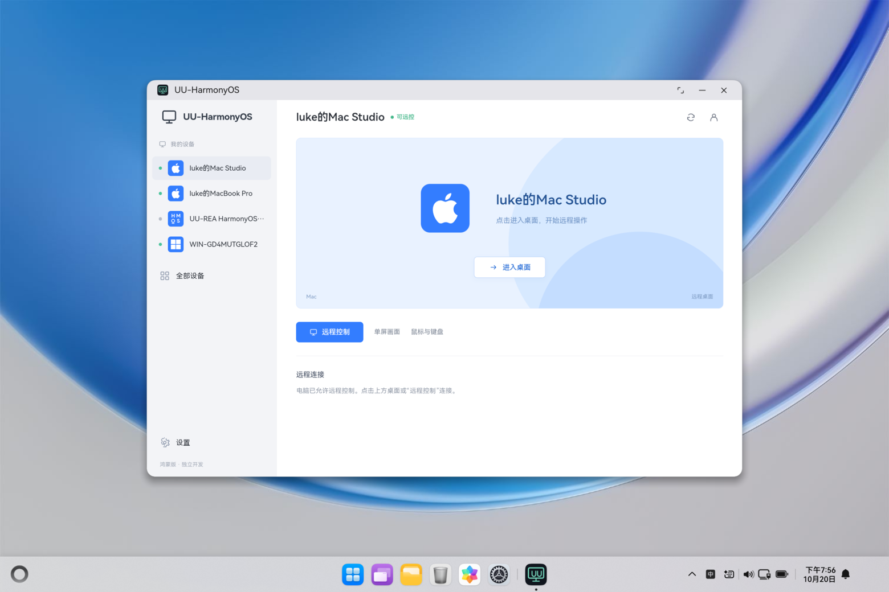
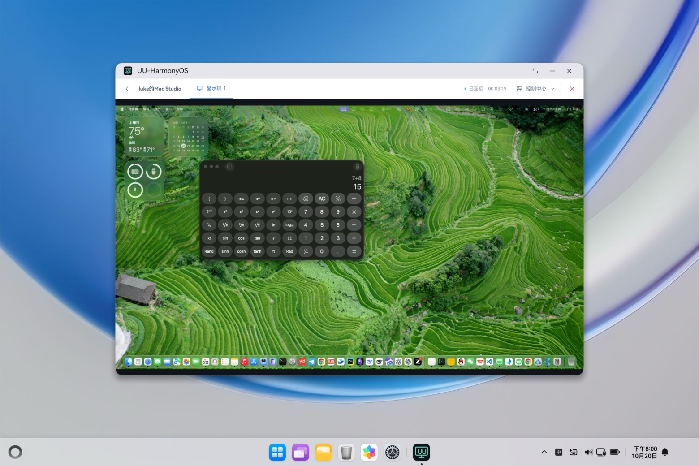

# UU-HarmonyOS

面向鸿蒙电脑的远程控制实验客户端，连接本人账号下的官方网易 UU Mac / Windows 客户端，查看和操作自己的电脑。项目独立开发，**不是网易官方产品**。

应用显示名称和项目目录均为 **UU-HarmonyOS**；侧栏、全部设备和预览使用苹果、Windows、HarmonyOS 三种平台图标。应用包名仍为 `com.luke.uurea`，现有安全存储标识保持稳定，以兼容已安装应用与登录态。

## 界面效果

以下截图为 2026-10-20 在 Mac 上官方 HarmonyOS 6.1 / API23 电脑（2in1）模拟器中的实际运行画面，被控端为同一账号下官方 UU Mac 客户端；属于模拟器证据，不代表鸿蒙实体电脑效果。

设备列表与详情（仅显示本人账号下设备，未知平台与当前不可控设备不允许连接）：



远程控制会话（单屏画面、连接计时与控制中心，演示中被控端打开计算器）：



## 支持范围与验证状态

已实现本人账号短信登录、登录态安全恢复、设备列表、单屏画面、鼠标、基础键盘、连接失败重试和主动断开。只允许已确认的 Mac / Windows 平台及允许控制的设备连接；不需要额外安装自建被控程序或 Node 网关。

以下是截至 **2026-10-20** 的实际验证，主控环境为 Mac 上的官方 HarmonyOS 6.1 / API23 电脑（2in1）模拟器，**不代表鸿蒙实体电脑验收**。

| 项目 | 状态 | 验证边界 |
| --- | --- | --- |
| 控制官方 Mac UU | PASS（本地模拟器） | 画面、鼠标、基础键盘、主动断开；稳定性版本通过同一媒体会话 20 分钟、20/20 次普通重连和 3/3 次冷启动。其中一轮重连经一次有限握手重试成功；受控信令故障后恢复及恢复后输入也已验证。 |
| 控制官方 Windows UU | PARTIAL | 曾实际通过画面、鼠标、基础键盘；后续仍出现信令心跳中断，持续连接稳定性未通过。 |
| 官方 Mac UU 中的设备分组 | PASS | 鸿蒙端已显示在“电脑”分组，官方客户端沿用 Mac 类别图标；本应用内按本端身份显示 HarmonyOS 图标。 |
| UU-HarmonyOS 名称与平台图标 | PASS（本地模拟器） | 覆盖安装、登录态恢复及界面核对通过；新版完成一次 Mac 连接、媒体更新与正常断开，未重跑完整 20 分钟/20 轮稳定性测试。 |
| 官方 Mac / Windows UU 反向控制鸿蒙 | 未完成 | 独立被控能力探针尚未完成屏幕采集、编码及 UU 协议集成，当前应用不提供被控功能。 |

当前不承诺任何网络下都能连接。中文/IME、完整多节点轮换和鸿蒙实体电脑兼容性尚未验收。测试版本、方法、历史失败和已知限制见[兼容性与验证结果](docs/兼容性与验证结果.md)。

## 项目结构

- `entry/`、`AppScope/`：ArkTS Stage 桌面应用、ArkWeb、原生网络桥、HUKS 和安全会话存储。
- `web/`：TypeScript 界面、UU 协议、WebRTC 媒体与输入通道、单元测试。
- `scripts/`：构建入口及原生策略、传输、签名和会话检查。
- `docs/`：架构与安全边界、兼容性与验证结果。
- `.local/`：已忽略的原始文档归档、本机研究、诊断和私人运行证据，不参与分发。

ArkTS 负责 HTTPS 和 Engine.IO / Socket.IO polling 信令，ArkWeb 负责视频与数据通道。网络请求保留系统 TLS 验证并限制目标域名；不会自动提取官方 UU 客户端的账号凭据。

## 本机构建

需要 macOS、DevEco Studio 及其内置 Node / JBR / HarmonyOS SDK。项目当前编译和目标 SDK 为 26，兼容下限为 HarmonyOS 6.1 / API23，以 [build-profile.json5](build-profile.json5) 为准。在 DevEco Studio 中打开仓库并完成 SDK 与项目依赖同步，然后在仓库根目录执行以下命令。首次直接从 DevEco 运行应用前，也须先生成网页资源：

```bash
export UU_REA_DEVECO="${UU_REA_DEVECO:-/Applications/DevEco-Studio.app/Contents}"
export PATH="$UU_REA_DEVECO/tools/node/bin:$PATH"
npm --prefix web ci --ignore-scripts
./scripts/check-all.sh
./scripts/build-all.sh
```

构建脚本默认查找 `/Applications/DevEco-Studio.app/Contents`；若 DevEco 安装在其他位置，先将 `UU_REA_DEVECO` 设置为其 `Contents` 目录，再执行上述命令，例如：

```bash
export UU_REA_DEVECO="/path/to/DevEco-Studio.app/Contents"
```

完整构建会生成网页资源、复制到 `entry/src/main/resources/rawfile/` 并打包鸿蒙应用；这些生成资源不纳入 Git。产物为 `entry/build/default/outputs/default/entry-default-unsigned.hap`。首次克隆及 Web 修改后应运行 `build-all.sh`，保持源码与打包资源一致；仅执行原生构建或直接从 DevEco 运行不会自动更新网页。

`check-all.sh` 运行 Web 单元测试、TypeScript 检查，以及原生网络策略、传输、签名和安全会话的离线检查，不访问 UU 服务或操作设备。

构建不包含开发者证书或签名配置。实体设备安装需要自己的 HarmonyOS 开发者签名及设备调试授权；编译、签名、安装与远控成功分别验证。连接模拟器或调试设备后，可使用 DevEco 内置 `hdc list targets` 检查目标。

## 首次运行与凭据

1. 在“设置 → 开发者设置 → 协议材料”中，通过本地密码框导入合法获得且与 UU 协议匹配的签名材料。材料写入鸿蒙 HUKS，不随源码或安装包分发；缺失时显示 `MATERIAL_MISSING` 并阻止认证请求。
2. 在应用内使用本人手机号与短信验证码登录；被控电脑的官方 UU 客户端须登录同一账号并允许控制。
3. 选择可控制的 Mac 或 Windows 进入桌面，结束后使用“退出远控”正常断开。

登录 Token 与主控身份使用 AssetStoreKit 加密保存，启动恢复后向 UU 验证；退出登录会删除，业务码 1120 会使登录态失效。手机号、验证码和房间凭据不持久化，安全存储失败不会回退为明文。

不要将验证码、Token、连接密码、签名材料或签名证书写入源码、普通配置、日志、截图或 Git。本地 macOS 辅助工具优先从 Login Keychain 读取凭据，映射见 [AGENTS.md](AGENTS.md)。

## 文档与来源

- [架构与安全边界](docs/架构与安全边界.md)
- [兼容性与验证结果](docs/兼容性与验证结果.md)

原始方案、调研和逐轮调试记录保留在本地归档；仓库文档汇总仍适用于当前实现的设计与分版本验证结论。

协议与浏览器会话参考 MIT 许可的 [fang12100/uuremote 固定提交](https://github.com/fang12100/uuremote/tree/aa2e12af69031f7d74eb6a86d967317ac5957053)。平台图标来自 Simple Icons 固定版本，采用 CC0-1.0。具体复用范围、固定来源及许可全文见 [THIRD_PARTY_NOTICES.md](THIRD_PARTY_NOTICES.md)。原 OpenUUYC 整体未采用开源许可，本项目不复制其原创实现。
